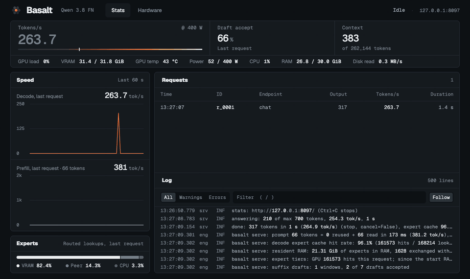
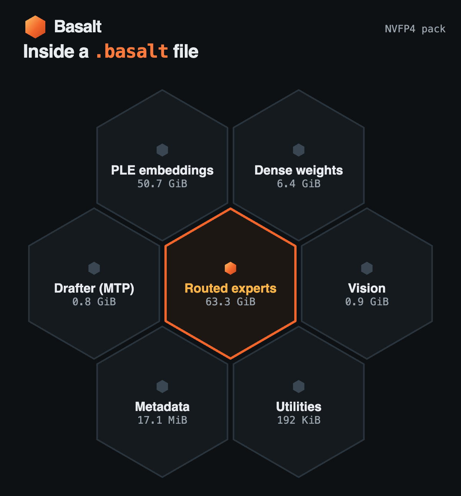

<p align="center"><picture><source media="(prefers-color-scheme: dark)" srcset="assets/basalt-lockup-dark.png"></picture></p>

**Basalt Ampere** is a fork of [Basalt](https://github.com/jesdga95/basalt), a local inference engine for the **Qwen3.8-Flash-Next** mixture-of-experts model.
This fork targets NVIDIA RTX 3090 / Ampere (sm_86) on Windows and Linux. See [Ampere setup](docs/ampere.md) for build instructions, validation and memory limits.

Experts that do not fit in VRAM live in system RAM, and optionally on a second GPU used as a peer expert tier.
A large MoE model runs on one workstation, behind an OpenAI- and Anthropic-compatible API.

**Help wanted:** have some spare compute to lend for testing? See [Contributing](CONTRIBUTING.md#other-ways-to-help).

<p align="center"></p>

## Requirements

- Windows x64 or Linux x86-64 with AVX2 (AVX-512 is used when present), and an NVIDIA GPU of compute capability 8.6 (or an explicit 12.0 build) with CUDA 13.
- CMake 3.24 or newer, a C++20 compiler, and Python 3.10 or newer.
- Windows builds use Visual Studio 2022 C++ Build Tools and Ninja; see [Windows setup](docs/ampere.md#windows-build).
- Enough system RAM to hold the experts that do not fit in VRAM.

## Quick start

The commands below are for Linux. On Windows, follow [Windows setup](docs/ampere.md#windows-build),
download the model, then use the double-click launchers below.

```sh
git clone https://github.com/penchopenchov/basalt-ampere && cd basalt-ampere
cmake -S . -B build -DCMAKE_BUILD_TYPE=Release
cmake --build build -j                  # bin/basalt, bin/basalt-bench, bin/basalt-probe, bin/basalt-vision
pip install -r requirements.txt
pip install huggingface_hub             # provides the hf download command
hf download jesdga/Qwen3.8-Flash-Next-Basalt Qwen3.8-FN-GSQ-RCO-IQ3_XXS.basalt --local-dir models
mkdir -p models/profiles
```

The supplied `basalt_config.json` selects IQ3_XXS, 256K context (262144 tokens
including the prompt and reply), int8 KV and
experimental expert staging. A bounded RAM cache leaves long-prompt headroom,
and a saved expert profile carries learned placement across launches.
See [context and warm starts](docs/ampere-context.md) for settings and tradeoffs.
Set `server.model` there if the downloaded file
is elsewhere. Staging changes numerical results; its full Q8_0 quality gate
remains unvalidated. See [Ampere setup](docs/ampere.md) for the measured checks.

```sh
bin/basalt serve --config basalt_config.json
```

The supplied configuration listens on `127.0.0.1:8088`; the interface and API
share that port. The OpenAI-compatible API base is `http://127.0.0.1:8088/v1`.

On Windows, after [setup](docs/ampere.md#windows-build), double-click:

- [Start Basalt.bat](<Start Basalt.bat>) to start the server. Keep its window open while using Basalt.
- [Open Basalt UI.bat](<Open Basalt UI.bat>) to open the interface. It starts the server if needed;
  the interface shows model-loading progress while the weights load.

## Models

<p align="center"></p>

Ready-to-run packs, with the quality of each measured against Q8_0, are on
[Hugging Face](https://huggingface.co/jesdga/Qwen3.8-Flash-Next-Basalt):
`Qwen3.8-FN-NVFP4`, `-UD-Q4_K_XL`, `-UD-Q5_K_XL`, `-UD-Q6_K_XL`, `-Q8_0`, `-GSQ-RCO-IQ3_S`, `-GSQ-RCO-IQ3_XXS` and `-GSQ-RCO-Q2_0` (each `.basalt`).
A model is one file: weights, tokenizer, MTP drafter, expert profile and vision projector.

## Docs

- [Configuration](docs/configuration/index.md): every setting.
- [Running](docs/running.md): parallel requests, prompt chunks, memory floors, image input.
- [basalt-probe](docs/probe.md): measures the machine, the cold decode speed, and suggests values.
- [The .basalt model file](docs/model-file.md): the layout, and building a pack yourself (including NVFP4).
- [Platforms](docs/platforms.md): Linux and Windows requirements, the build steps and the Windows limitations.
- [Changelog](docs/changelog/index.md): what each release changed.
- [Building and testing](docs/building.md), [Precision and quality](docs/precision/index.md), [Contributing](CONTRIBUTING.md).

## Credits

- [Strata](https://github.com/Niko1221/Strata): the project Basalt forks (MIT).
- [Qwen](https://huggingface.co/Qwen/Qwen3.8-Flash-Next): the model. The packs are under the [Qwen Community License 1.0](https://huggingface.co/Qwen/Qwen3.8-Flash-Next/blob/main/LICENSE), not Basalt's MIT license.
- [unsloth](https://huggingface.co/unsloth): the UD and Q8_0 GGUFs the packs are built from.
- IST Austria DAS Lab: the GSQ-RCO quants; please cite [GSQ](https://arxiv.org/abs/2604.18556) and [RCO](https://arxiv.org/abs/2605.00649).
- [NVIDIA](https://huggingface.co/nvidia/Qwen3.8-Flash-Next-NVFP4): the NVFP4 experts.
- [ggml and llama.cpp](https://github.com/ggml-org/llama.cpp): quantization formats and kernels extracted into `src/` (MIT, see [THIRD_PARTY_LICENSES](THIRD_PARTY_LICENSES)).

## License

MIT, see [LICENSE](LICENSE).
